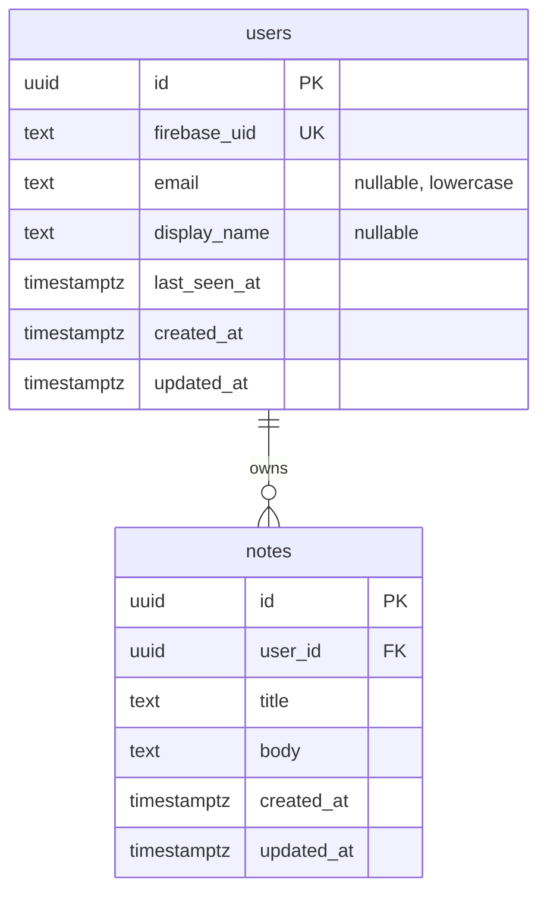

# Template Starter Profil A

## 1. Context & Goal

Repo ini adalah **template starter** untuk setiap proyek Profil A (Flutter untuk web, Android, iOS + API Hono + PostgreSQL + Firebase). Proyek baru dibuat dari template ini, lalu Claude Code mengerjakan `docs/TASKS.md` proyek itu di atasnya.

Masalah yang diselesaikan: pada uji coba sebelumnya (repo `gym-membership`), hampir semua keputusan yang diambil agent sendiri adalah **konvensi proyek** (letak test, format error, alur Git, konfigurasi tool, cara menjalankan emulator). Template ini mengunci konvensi tersebut di kode, di `docs/conventions.md`, dan di `CLAUDE.md`, sehingga agent meniru pola yang sudah ada.

Tujuan:

- Clone baru bisa diverifikasi dengan tiga perintah: `pnpm prereq`, `docker compose up -d --wait`, `pnpm check`.
- Satu fitur contoh (**notes**) menunjukkan pola lengkap dari database sampai UI Flutter, untuk ditiru lalu dihapus.
- Tidak ada domain bisnis di template.

## 2. Scope

### In scope

- Root monorepo: workspace pnpm, konfigurasi versi, Biome, `.gitattributes`, `scripts/prereq.mjs`, `scripts/check.mjs`.
- Layanan lokal lewat Docker Compose: PostgreSQL, Firebase Auth Emulator, Firebase Storage Emulator.
- API Hono: konfigurasi env, format error, logger dengan redaksi, CORS, `/health`, autentikasi Firebase, `GET /v1/me`, pagination cursor, pg-boss, port `PushSender` dan `FileStorage`, fitur contoh notes.
- Database: Drizzle, migrasi, database test terpisah.
- Kontrak: export `openapi.json` dan client Dart hasil generate, dengan pemeriksaan sinkron.
- Flutter: kerangka Clean Architecture, login Firebase, fitur contoh notes.
- CI GitHub Actions, Dockerfile API, dokumentasi (`README.md`, `docs/conventions.md`, `CLAUDE.md`), dan script untuk memulai proyek baru dari template.

### Non-goals

- Domain bisnis apa pun, organisasi atau tenancy, dan peran selain "user yang login".
- Wiring FCM di Flutter, penyimpanan token perangkat, dan UI upload file.
- Konfigurasi Firebase produksi (`flutterfire configure`), rilis ke Play Store dan App Store, dan deploy otomatis.
- Monitoring di luar log JSON.
- Profil B (Next.js).

## 3. Tech Constraints

### Versi

| Komponen | Versi |
| --- | --- |
| Node.js | 24 LTS (`.nvmrc` berisi `24`, `engines.node` `>=24 <25`) |
| pnpm | versi yang terpasang saat T-001, dipin lewat `packageManager` |
| PostgreSQL | 17 (image `postgres:17-alpine`) |
| Flutter | stable yang terpasang saat T-004, dicatat di README dan dipakai CI |
| Library | versi pasti dipin saat pertama dipasang dan dicatat di `docs/conventions.md` |

### Pohon folder

```
.
├── CLAUDE.md
├── README.md
├── .gitattributes .gitignore .editorconfig .nvmrc
├── .env.example
├── package.json               # script: prereq, check, dev, contract:generate, contract:check, init-project
├── pnpm-workspace.yaml
├── biome.json
├── docker-compose.yml
├── docker/firebase-emulator/Dockerfile
├── firebase.json .firebaserc storage.rules
├── scripts/                   # prereq.mjs, check.mjs, init-project.mjs
├── .github/workflows/ci.yml
├── docs/
│   ├── PRD.md TASKS.md        # dokumen proyek (template: placeholder)
│   ├── conventions.md
│   ├── logs/
│   └── template-build/        # PRD dan TASKS pembangunan template (dipindah di T-020)
├── apps/api/
│   ├── Dockerfile
│   ├── drizzle.config.ts vitest.config.ts vitest.int.config.ts tsconfig.json
│   ├── drizzle/               # migrasi SQL, di-commit
│   ├── scripts/export-openapi.ts
│   ├── src/
│   │   ├── app.ts server.ts
│   │   ├── core/
│   │   │   ├── config/        # env.ts
│   │   │   ├── http/          # errors.ts, error-codes.ts, context.ts, pagination.ts, cors.ts
│   │   │   ├── auth/          # firebase-admin.ts, authenticate.ts
│   │   │   ├── jobs/          # boss.ts, heartbeat.job.ts
│   │   │   ├── ports/         # push-sender.ts, file-storage.ts, adapters/
│   │   │   └── logger.ts
│   │   ├── db/                # client.ts, migrate.ts, schema/ (columns.ts, users.ts, notes.ts, index.ts)
│   │   └── features/
│   │       ├── system/http/   # health.route.ts
│   │       ├── users/         # domain/, usecases/, infrastructure/, http/
│   │       └── notes/         # CONTOH: domain/, usecases/, infrastructure/, http/
│   └── test/
│       ├── unit/              # mengikuti struktur src/
│       ├── int/               # *.int.test.ts
│       ├── helpers/           # test-app.ts, emulator-token.ts, factories.ts
│       └── setup/             # env.ts, db.ts
├── packages/contract/
│   ├── openapi.json           # di-commit
│   └── dart/                  # package Dart `api_client`, di-commit
└── apps/app/
    ├── pubspec.yaml analysis_options.yaml
    ├── config/dev.json
    ├── lib/
    │   ├── main.dart app.dart
    │   ├── core/              # config/, di/, error/, network/, router/, theme/, l10n/
    │   └── features/
    │       ├── auth/          # domain/, data/, presentation/
    │       └── notes/         # CONTOH: domain/, data/, presentation/
    └── test/                  # mengikuti struktur lib/
```

### Konvensi

- **Git:** branch `<type>/t-xxx-<ringkas>` (type: feat, fix, chore, docs, test), commit `<type>: <ringkasan> (T-xxx)`, merge ke `master` oleh user. `.gitattributes` memaksa LF (kecuali `*.bat` dan `*.cmd`).
- **API:** prefix `/v1` untuk semua endpoint kecuali `/health`; resource jamak; JSON camelCase; timestamp ISO 8601 UTC berakhiran `Z`; tanggal kalender string `YYYY-MM-DD`.
- **Error:** lihat bagian 5.
- **Pagination:** cursor, `?limit=20&cursor=<opaque>`, `limit` 1–100 (default 20), respons `{ items, nextCursor }` dengan `nextCursor: null` di halaman terakhir. Cursor adalah base64url dari `createdAt|id`, urutan `created_at DESC, id DESC`.
- **Database:** tabel snake_case jamak; `id uuid default gen_random_uuid()`; `created_at` dan `updated_at` `timestamptz` (`updated_at` lewat `$onUpdate` Drizzle); enum sebagai `text` + CHECK; kolom `date` dengan `mode: 'string'`; aturan bisnis penting ditegakkan dengan constraint.
- **TypeScript:** `strict`, `module` dan `moduleResolution` `NodeNext`, import relatif berakhiran `.js`; lint dan format dengan Biome.
- **Clean Architecture API:** `http` (route + skema Zod) → `usecases` → interface repository di `domain` ← implementasi di `infrastructure`. Use case tidak mengimpor Hono atau Drizzle.
- **Clean Architecture Flutter:** `presentation` (widget + Bloc/Cubit) → `domain` (entity Dart murni dengan equatable, interface repository, use case dengan satu metode `call`) ← `data` (data source memakai `api_client`, mapper DTO → entity, implementasi repository). Domain tidak mengimpor Flutter, dio, atau DTO.
- **Flutter lainnya:** state Bloc sebagai sealed class Dart 3; get_it dengan registrasi manual per fitur (`registerNotesDependencies()`) yang dipanggil dari `core/di`; go_router; error sebagai `Result<T>` (sealed: `Ok`, `Err` berisi `Failure`); teks UI Bahasa Indonesia.
- **Test:** tidak ada kode tanpa test. API: unit test di `test/unit`, integration test di `test/int` memakai database `<POSTGRES_DB>_test` yang dibuat ulang setiap run dan di-`TRUNCATE` sebelum setiap test. Flutter: `bloc_test` dan `mocktail`.
- **Script lintas platform:** semua script otomatisasi ditulis dalam Node (`.mjs`), bukan shell, agar berjalan sama di CMD, PowerShell, Git Bash, dan Linux CI.

### Prasyarat lingkungan

Diperiksa oleh `pnpm prereq`:

| Prasyarat | Wajib | Catatan |
| --- | --- | --- |
| Node.js 24 | ya | |
| pnpm (versi `packageManager`) | ya | lewat `corepack enable` |
| Git | ya | |
| Docker dengan engine hidup | ya | Docker Desktop di Windows |
| Flutter stable | ya | di Windows, Smart App Control dapat memblokir `dart.exe` |
| Android SDK + emulator | tidak | hanya untuk verifikasi Android |
| File `.env` | ya | dibuat user dari `.env.example`; agent tidak membuatnya |

## 4. Data Model



Constraint dan index:

- `users.firebase_uid` UNIQUE; upsert memakai `ON CONFLICT (firebase_uid)` agar dua request pertama yang paralel tetap menghasilkan satu baris.
- `notes.user_id` FK ke `users.id` `ON DELETE CASCADE`.
- CHECK `char_length(title) BETWEEN 1 AND 120`, CHECK `char_length(body) <= 5000`; `body` NOT NULL default `''`.
- Index `notes (user_id, created_at DESC, id DESC)` untuk pagination cursor.
- Tabel pg-boss dikelola pg-boss sendiri di schema `pgboss`, bukan lewat migrasi Drizzle.

## 5. API Contract

### Format error

Semua error memakai satu bentuk:

```json
{ "error": { "code": "VALIDATION_ERROR", "message": "Request validation failed", "details": { "title": [ { "code": "too_small", "message": "String must contain at least 1 character(s)" } ] } } }
```

- `code`: salah satu `ErrorCode` di bawah. Nilainya stabil dan menjadi dasar teks untuk user di Flutter.
- `message`: bahasa Inggris untuk developer. Tidak ditampilkan ke user. Error 500 tidak pernah membocorkan pesan asli.
- `details`: hanya untuk `VALIDATION_ERROR`. Kunci adalah path field (bersarang digabung titik, misalnya `items.0.name`; tanpa path memakai `_root`). Nilai adalah array `{ code, message }`, dengan `code` dari kode issue Zod (`invalid_type`, `too_small`, `too_big`, `invalid_string`, dan seterusnya), kecuali field yang tidak dikirim memakai `required`.

| ErrorCode | HTTP | Kapan |
| --- | --- | --- |
| `BAD_REQUEST` | 400 | JSON rusak atau request tidak bisa diproses |
| `UNAUTHENTICATED` | 401 | Header `Authorization` tidak ada, token tidak valid, atau kedaluwarsa |
| `FORBIDDEN` | 403 | User terautentikasi tetapi tidak berhak (disediakan untuk proyek) |
| `NOT_FOUND` | 404 | Resource tidak ada, atau milik user lain |
| `CONFLICT` | 409 | Pelanggaran keunikan atau state |
| `VALIDATION_ERROR` | 422 | Validasi Zod gagal pada body, path, atau query |
| `INTERNAL_ERROR` | 500 | Error tak terduga |

Daftar `ErrorCode` diekspor ke OpenAPI sebagai enum, sehingga client Dart punya daftar yang sama.

### Autentikasi

Semua endpoint `/v1/*` mewajibkan header `Authorization: Bearer <Firebase ID token>`. Middleware memverifikasi token (ke Auth Emulator bila `FIREBASE_AUTH_EMULATOR_HOST` di-set), melakukan upsert `users`, lalu menaruh user di context.

### Endpoint

| Method dan path | Akses | Request | Response |
| --- | --- | --- | --- |
| GET /health | publik | — | `200 { "status": "ok" }` |
| GET /v1/me | login | — | `200 User` |
| GET /v1/notes | login | query `limit`, `cursor` | `200 { items: Note[], nextCursor: string \| null }` |
| POST /v1/notes | login | `{ title, body? }` | `201 Note` |
| GET /v1/notes/{id} | pemilik | — | `200 Note`; `404` bila tidak ada atau milik user lain |
| PATCH /v1/notes/{id} | pemilik | `{ title?, body? }` minimal satu field | `200 Note`; `404`; `422` |
| DELETE /v1/notes/{id} | pemilik | — | `204`; `404` |

`User`: `{ id, email, displayName, createdAt }`. `Note`: `{ id, title, body, createdAt, updatedAt }`. Semua `id` UUID; `id` yang bukan UUID di path menghasilkan `422`.

## 6. Functional Requirements

### FR-01: Cek prasyarat lingkungan

`pnpm prereq` memeriksa setiap prasyarat di bagian 3, menampilkan tabel status, dan memberi perintah perbaikan.

Acceptance criteria:
- [ ] Given semua prasyarat wajib terpenuhi, When `pnpm prereq` dijalankan, Then setiap baris berstatus OK dan exit code 0.
- [ ] Given Docker engine mati, When `pnpm prereq` dijalankan, Then baris Docker gagal dengan saran "jalankan Docker Desktop" dan exit code bukan 0.
- [ ] Given `.env` tidak ada, When `pnpm prereq` dijalankan, Then muncul perintah untuk menyalin `.env.example`, tanpa membuat `.env` sendiri.
- [ ] Given Flutter terpasang tetapi `dart` gagal dijalankan, When `pnpm prereq` dijalankan, Then pesannya menyebut kemungkinan Smart App Control.

Edge cases: prasyarat opsional yang tidak ada ditampilkan sebagai peringatan, bukan kegagalan.

### FR-02: Layanan lokal

`docker compose up -d --wait` menjalankan PostgreSQL (5432), Auth Emulator (9099), dan Storage Emulator (9199) sampai healthy, dengan project `demo-template`.

Acceptance criteria:
- [ ] Given Docker hidup, When `docker compose up -d --wait`, Then ketiga layanan healthy.
- [ ] Given layanan berjalan, When `GET http://localhost:9099/`, Then respons berisi `"ready": true`.
- [ ] Given `storage.rules`, When client tanpa aturan khusus mengakses Storage, Then akses ditolak.

Edge cases: waktu build ulang image emulator dicatat di log; data PostgreSQL bertahan di volume.

### FR-03: Satu perintah verifikasi

`pnpm check` menjalankan berurutan: Biome, typecheck API, unit test API, integration test API, `contract:check`, `flutter analyze`, `flutter test`, lalu menampilkan ringkasan per langkah.

Acceptance criteria:
- [ ] Given semua langkah lulus, When `pnpm check`, Then ringkasan menunjukkan semua OK dan exit code 0.
- [ ] Given satu langkah gagal, When `pnpm check`, Then langkah itu ditandai gagal, langkah lain tetap dilaporkan, dan exit code bukan 0.
- [ ] Given Docker mati, When `pnpm check`, Then integration test gagal dengan pesan yang menyebut Docker.

### FR-04: Kerangka API

Konfigurasi env tervalidasi, format error bagian 5, logger, CORS, dan `/health`.

Acceptance criteria:
- [ ] Given env wajib hilang, When server dijalankan, Then proses berhenti dengan pesan yang menyebut nama variabelnya.
- [ ] Given route tidak ada, When dipanggil, Then `404 NOT_FOUND` dengan format error standar.
- [ ] Given body tidak valid, When route ber-Zod dipanggil, Then `422 VALIDATION_ERROR` dengan `details` sesuai bagian 5, termasuk `required` untuk field yang tidak dikirim.
- [ ] Given error tak terduga, When terjadi, Then `500 INTERNAL_ERROR` tanpa pesan asli di respons, tetapi tercatat di log.
- [ ] Given request apa pun, When dicatat di log, Then header `Authorization` dan field `token`, `idToken`, `email`, `phone` diredaksi, dan query string tidak dicatat.
- [ ] Given origin ada di `CORS_ORIGINS`, When preflight dikirim, Then diizinkan; origin lain ditolak.

### FR-05: Database

Drizzle, migrasi yang di-commit, dan database test terpisah.

Acceptance criteria:
- [ ] Given database kosong, When `pnpm --filter api db:migrate` dijalankan dua kali, Then keduanya sukses (idempoten).
- [ ] Given skema Drizzle, When `drizzle-kit generate` dijalankan ulang, Then tidak ada perubahan.
- [ ] Given integration test berjalan, When selesai, Then database utama tidak tersentuh.

### FR-06: Autentikasi dan `GET /v1/me`

Acceptance criteria:
- [ ] Given tanpa header, When `GET /v1/me`, Then `401 UNAUTHENTICATED`.
- [ ] Given token tidak valid atau kedaluwarsa, When `GET /v1/me`, Then `401` dan tidak ada baris `users` baru.
- [ ] Given token valid dari emulator, When `GET /v1/me` pertama kali, Then satu baris `users` dibuat dan respons `200 User`.
- [ ] Given dua request pertama paralel dengan token yang sama, When selesai, Then tetap satu baris `users`.
- [ ] Given email di token berubah, When request berikutnya, Then `users.email` dan `last_seen_at` diperbarui.

### FR-07: Job terjadwal

pg-boss berjalan di proses API bila `RUN_WORKER=true`, dengan job contoh `system.heartbeat` setiap 5 menit yang hanya menulis log.

Acceptance criteria:
- [ ] Given `RUN_WORKER=true`, When server start, Then pg-boss start dan job terjadwal terdaftar.
- [ ] Given job dikirim, When worker berjalan, Then handler dipanggil (dibuktikan integration test).
- [ ] Given SIGTERM, When diterima, Then server berhenti menerima request, pg-boss berhenti dengan graceful, lalu proses keluar.
- [ ] Given `RUN_WORKER` tidak di-set, When server start, Then pg-boss tidak dijalankan.

### FR-08: Port push dan storage

Acceptance criteria:
- [ ] Given `PUSH_ADAPTER=fake`, When `PushSender.send()` dipanggil, Then pesan tercatat di adapter palsu dan bisa diperiksa test.
- [ ] Given adapter FCM, When dibuat, Then memakai firebase-admin messaging dan diuji dengan mock (tidak ada emulator FCM).
- [ ] Given Storage Emulator berjalan, When `FileStorage` menyimpan, membaca, dan menghapus file lewat adapter Firebase Storage, Then integration test lulus.

### FR-09: Fitur contoh notes (API)

CRUD notes sesuai bagian 5, hanya untuk pemilik.

Acceptance criteria:
- [ ] Given user A membuat note, When user B `GET /v1/notes/{id}` milik A, Then `404 NOT_FOUND`.
- [ ] Given 25 notes, When `GET /v1/notes?limit=10` diikuti `nextCursor` dua kali, Then total 25 notes tanpa duplikat dan `nextCursor` terakhir `null`.
- [ ] Given `title` kosong atau lebih dari 120 karakter, When `POST /v1/notes`, Then `422` dengan `details.title`.
- [ ] Given `PATCH` tanpa field, When dipanggil, Then `422` dengan `details._root`.
- [ ] Given note dihapus, When `GET` ulang, Then `404`.
- [ ] Given cursor rusak, When `GET /v1/notes?cursor=xyz`, Then `422` dengan `details.cursor`.

### FR-10: Kontrak dan client Dart

Acceptance criteria:
- [ ] Given route API, When `pnpm contract:generate`, Then `packages/contract/openapi.json` dan package `api_client` diperbarui, dan `api_client` lolos `dart analyze`.
- [ ] Given route diubah tanpa generate ulang, When `pnpm contract:check`, Then gagal dengan pesan file mana yang tidak sinkron.
- [ ] Given `openapi.json`, When diperiksa, Then `ErrorCode` muncul sebagai enum dan skema error dipakai semua respons error.

### FR-11: Kerangka Flutter

Acceptance criteria:
- [ ] Given `config/dev.json`, When app dijalankan dengan `--dart-define-from-file=config/dev.json`, Then `AppConfig` terisi; di Android emulator host `localhost` otomatis menjadi `10.0.2.2`.
- [ ] Given API mengembalikan error dengan `code`, When diterima dio, Then dipetakan ke `Failure` dengan `code`, dan teks Bahasa Indonesia diambil dari peta `code` (dengan teks umum sebagai cadangan).
- [ ] Given user login, When request API dikirim, Then interceptor menambahkan ID token terbaru; bila respons `401`, token di-refresh sekali lalu request diulang.
- [ ] Given `flutter analyze` dan `flutter test`, When dijalankan, Then bersih dan lulus.

### FR-12: Login Flutter

Login, daftar, dan logout dengan email dan password lewat Firebase Auth, memakai Auth Emulator saat `USE_EMULATOR=true`.

Acceptance criteria:
- [ ] Given belum login, When membuka rute yang dilindungi, Then diarahkan ke halaman login.
- [ ] Given kredensial benar di emulator, When login, Then masuk ke halaman notes.
- [ ] Given password salah, When login, Then tampil pesan Bahasa Indonesia yang jelas.
- [ ] Given sudah login, When logout, Then kembali ke halaman login.
- [ ] (manual) Given web (Chrome) dan Android emulator, When alur daftar, login, logout dicoba, Then berjalan di keduanya.

### FR-13: Fitur contoh notes (Flutter)

Acceptance criteria:
- [ ] Given daftar notes, When digulir sampai bawah, Then halaman berikutnya dimuat memakai `nextCursor`.
- [ ] Given form note, When disimpan dengan judul kosong, Then error validasi tampil di field judul.
- [ ] Given note milik sendiri, When diubah atau dihapus, Then daftar diperbarui.
- [ ] Given API mati, When daftar dibuka, Then tampil pesan kesalahan jaringan dan tombol coba lagi.
- [ ] (manual) Given web dan Android emulator, When alur buat, ubah, hapus dicoba, Then berjalan di keduanya.

### FR-14: CI

Acceptance criteria:
- [ ] Given push atau pull request, When workflow berjalan, Then langkah yang sama dengan `pnpm check` dijalankan dengan service PostgreSQL dan emulator.
- [ ] Given `contract:check` gagal, When CI berjalan, Then workflow gagal.

### FR-15: Container API

Acceptance criteria:
- [ ] Given `apps/api/Dockerfile`, When image di-build, Then image berisi hasil build produksi tanpa dependency dev.
- [ ] Given container dijalankan dengan env yang benar, When `GET /health`, Then `200`; migrasi dijalankan lewat perintah terpisah (`node dist/db/migrate.js`).

### FR-16: Dokumentasi dan proyek baru

Acceptance criteria:
- [ ] Given `docs/conventions.md`, When dibaca, Then memuat semua konvensi bagian 3 dan 5 beserta versi library yang dipin.
- [ ] Given `pnpm init-project <nama>`, When dijalankan, Then nama project Firebase `demo-<nama>`, nama database, dan README diperbarui, `docs/PRD.md` dan `docs/TASKS.md` diganti placeholder, dan `docs/logs/` dikosongkan.
- [ ] Given README, When diikuti dari clone baru, Then pembaca bisa sampai `pnpm check` hijau tanpa bantuan lain.

## 7. Non-Functional Requirements

- **NFR-01 Lintas platform:** semua script dan perintah di README berjalan di Windows (CMD, PowerShell, Git Bash) dan Linux (CI).
- **NFR-02 Waktu verifikasi:** `pnpm check` selesai di bawah 5 menit di laptop pengembang setelah dependency terpasang (image emulator sudah ada).
- **NFR-03 Keamanan default:** semua endpoint `/v1/*` menolak request tanpa token (dibuktikan test yang mengiterasi semua route terdaftar); `storage.rules` menolak semua akses; tidak ada secret di repo.
- **NFR-04 Privasi log:** data sensitif diredaksi sesuai FR-04.
- **NFR-05 Cakupan test:** setiap file di `src/core` dan setiap use case punya test.
- **NFR-06 Keterbacaan untuk agent:** setiap folder fitur contoh punya pola yang sama di API dan Flutter, dan `docs/conventions.md` merujuk file contoh untuk setiap konvensi.

## 8. Assumptions & Decisions

| ID | Keputusan | Alasan |
| --- | --- | --- |
| D-01 | Kontrak code-first: Zod di route Hono → `openapi.json` yang di-commit | Satu sumber kebenaran; CI gagal jika tidak sinkron |
| D-02 | Client Dart dengan swagger_parser; cadangan openapi-generator `dart-dio` lewat Docker | Tanpa Java, berjalan di toolchain Flutter di Windows; divalidasi di T-003 |
| D-03 | Server mengirim `code` + `message` Inggris; Flutter menerjemahkan `code` ke Bahasa Indonesia | Teks untuk user di satu tempat; API tidak berubah saat teks berubah |
| D-04 | Flutter memakai project `demo-template` dengan FirebaseOptions dummy lewat `--dart-define-from-file` | Development tanpa project Firebase sungguhan; divalidasi di T-004 |
| D-05 | pg-boss dipasang penuh di proses API (`RUN_WORKER=true`) | Lifecycle mahal diperbaiki belakangan |
| D-06 | FCM dan Storage sebagai port + adapter, tanpa wiring Flutter | FCM tanpa emulator; aturan Storage berbeda per proyek |
| D-07 | Resource milik user lain dijawab `404`, bukan `403` | Tidak membocorkan keberadaan resource; `FORBIDDEN` disediakan untuk aturan peran di proyek |
| D-08 | Biome untuk lint dan format TS; cadangan ESLint + Prettier | Satu alat, satu konfigurasi; divalidasi di T-001 |
| D-09 | pnpm workspaces tanpa Turborepo | Cukup untuk tiga paket |
| D-10 | Node 24 LTS | LTS aktif per September 2026 |
| D-11 | Organisasi dan tenancy tidak di template; polanya dijelaskan di `conventions.md` | Tidak semua proyek multi-user |
| D-12 | Script otomatisasi dalam Node `.mjs` | Heredoc dan script shell gagal di Windows pada uji sebelumnya |
| D-13 | Kode dari repo uji `gym-membership` menjadi rujukan untuk Docker Compose, logger, error, dan Drizzle | Sudah terbukti berjalan; format `details` diubah sesuai bagian 5 |
| D-14 | Cek prasyarat bernama `pnpm prereq` (`scripts/prereq.mjs`), bukan `pnpm doctor`; nama script root tidak boleh sama dengan perintah bawaan pnpm (cek dengan `pnpm help <nama>`) | pnpm 12 punya perintah bawaan `pnpm doctor` yang selalu menang atas script `package.json`; ditemukan dan diputuskan user di T-001 |

### Open Questions

- Tidak ada. Keputusan yang sebelumnya terbuka sudah diputuskan di atas; hasil spike di T-001 sampai T-004 bisa mengubah D-02, D-04, atau D-08, dan perubahan itu dicatat di log serta di tabel ini.
